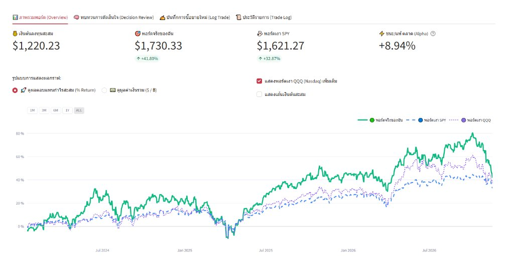
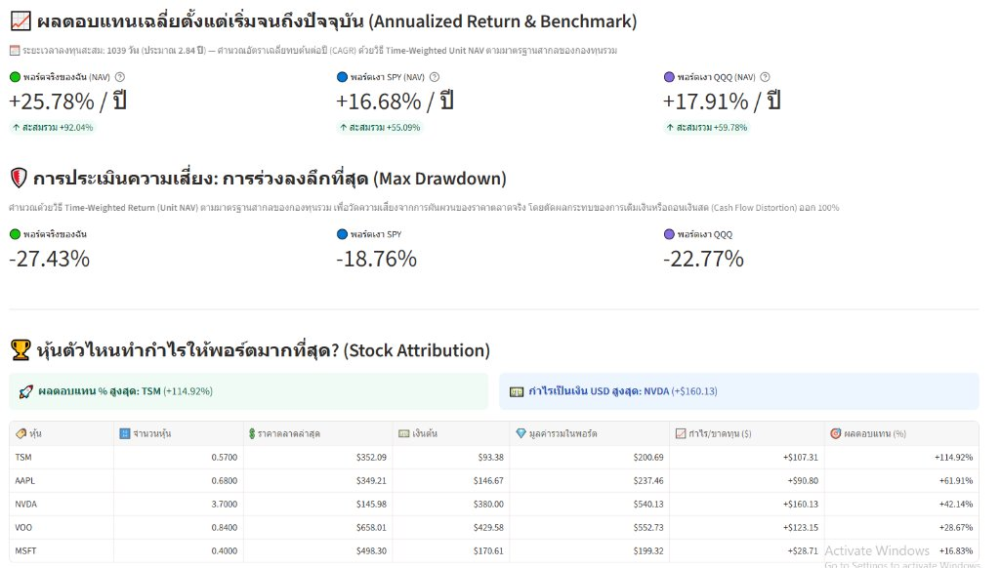
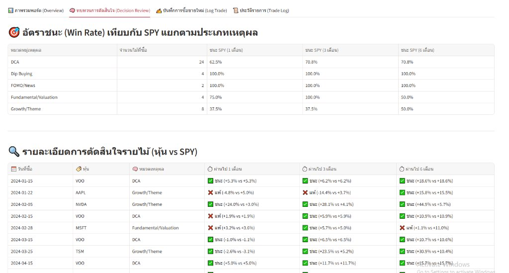

# 📈 Stock Journal & Shadow Benchmark System

ระบบ `ETL Pipeline` และ Dashboard วิเคราะห์พอร์ตออมหุ้นสหรัฐฯ ที่ช่วยจำลองพอร์ตคู่ขนาน (`Shadow Portfolio`) ด้วยเงินก้อนเดียวกันในวันเดียวกันเทียบกับดัชนี `SPY` และ `QQQ` อัตโนมัติทุกวัน เพื่อพิสูจน์ด้วยตัวเลขจริงว่าการเลือกหุ้นเองชนะตลาดไหม และเหตุผลในการซื้อแบบไหนที่ทำเงินหรือพาพอร์ตพัง

> 🔗 **Live Dashboard (เว็บใช้งานจริง):** https://stock-journal-4i7wnvrpwpnwdrck6vbm98.streamlit.app/

### 📸 ตัวอย่างหน้าจอ Dashboard

**1. ภาพรวมพอร์ตจริงเทียบกับพอร์ตเงา (`Overview` — Real vs Shadow `SPY` / `QQQ`)**


**2. ผลตอบแทนทบต้น (`CAGR`), ความเสี่ยง (`Max Drawdown`) และกำไรรายหุ้น (`Stock Attribution`)**


**3. วัดผลความแม่นยำแยกตามเหตุผลการซื้อ (`Decision Review`)**


---

## 1. ปัญหาที่เจอจริง (ทำไมแอปโบรกเกอร์ทั่วไปถึงไม่พอ)

แอปเทรดหุ้นทั่วไปบอกเราแค่ว่าวันนี้พอร์ตเขียวหรือแดงกี่บาท แต่ไม่เคยตอบคำถามสำคัญที่สุดของคนที่ทยอยออมหุ้น (DCA) ได้เลย 2 ข้อ:

1. **ที่เราขยันเลือกหุ้นเอง ชนะการซื้อดัชนีตลาดทิ้งไว้เฉยๆ ไหม:** แค่เห็นพอร์ตบวกไม่ได้แปลว่าเก่ง ถ้าเอาเงินจำนวนเท่ากันในวันเดียวกันไปซื้อ `SPY` หรือ `QQQ` เฉยๆ อาจได้ผลตอบแทนดีกว่าและเสี่ยงน้อยกว่าก็ได้
2. **ไม้ที่ซื้อเพราะวิเคราะห์พื้นฐาน เทียบกับซื้อเพราะกลัวตกรถ (`FOMO`) พฤติกรรมไหนทำเงินกันแน่:** ถ้าไม่บันทึกเหตุผลกำกับไว้ตอนกดซื้อ แล้วเอากลับมาวัดผลหลังผ่านไป 1, 3 และ 6 เดือน เราก็จะจำแต่ไม้ที่กำไรแล้วเผลอทำพฤติกรรมเดิมซ้ำๆ

ระบบนี้จึงสร้าง **พอร์ตเงา (`Shadow Portfolio`)** ขึ้นมาเดินคู่ขนานตั้งแต่วันแรก เพื่อเป็นกระจกสะท้อนทั้งฝีมือการเลือกหุ้นและวินัยการลงทุนด้วยข้อมูลจริง

---

## 2. ตัวอย่าง Insight ที่ได้จากข้อมูล (Sample Business Insights)

ข้อมูลด้านล่างดึงจากฐานข้อมูลจำลอง [stock_journal.db](stock_journal.db) ณ วันที่ **20 พฤศจิกายน 2026** (ระยะเวลาสะสม **1,040 วัน / 2.85 ปี**, เงินต้นสะสม **$1,220.23**, ทั้งหมด **42 รายการซื้อ**)

### ตารางที่ 1: เทียบพอร์ตจำลองกับดัชนีตลาด (`Shadow Portfolio`)

| พอร์ตการลงทุน | มูลค่าปัจจุบัน (USD) | ผลตอบแทนสะสม | `Unit NAV` Return | `CAGR` (จาก `Unit NAV`) | `Max Drawdown` |
| :--- | :---: | :---: | :---: | :---: | :---: |
| **พอร์ตจำลอง (Real Portfolio)** | **$1,606.73** | **+31.67%** | **+78.33%** | **+22.53% / ปี** | **-27.43%** |
| **Shadow `SPY` (S&P 500)** | $1,562.25 | +28.03% | +49.45% | +15.15% / ปี | -18.76% |
| **Shadow `QQQ` (Nasdaq 100)** | $1,574.89 | +29.07% | +50.71% | +15.50% / ปี | -22.77% |

* **สรุปการตัดสินใจ:** การเลือกหุ้นเองในชุดข้อมูลนี้ทำ `CAGR` (`+22.53%/ปี`) ชนะทั้ง `SPY` และ `QQQ` แต่ต้องแลกกับความเสี่ยงขาลง (`Max Drawdown`) ที่ร่วงลึกถึง `-27.43%` หนักกว่า `SPY` เกือบ 9 เปอร์เซ็นต์

### ตารางที่ 2: ผลลัพธ์แยกตามเหตุผลการซื้อเทียบกับ `SPY` (`Decision Review`)

| เหตุผลการซื้อ (`reason_category`) | จำนวนไม้ | `Win Rate` 1 เดือน | `Win Rate` 3 เดือน | `Win Rate` 6 เดือน | ผลตอบแทนเฉลี่ย 6 เดือน (vs `SPY`) |
| :--- | :---: | :---: | :---: | :---: | :---: |
| `Dip Buying` (รอซื้อช่วงย่อ) | 4 | **100.0%** | **100.0%** | **100.0%** | **+46.28%** (vs +14.08%) |
| `Fundamental/Valuation` (ดูพื้นฐาน) | 4 | 75.0% | **100.0%** | 50.0% | **+16.37%** (vs +11.47%) |
| `DCA` (ออมสม่ำเสมอ) | 24 | 62.5% | 70.8% | 70.8% | +8.20% (vs +8.69%) |
| `Growth/Theme` (ตามธีมเติบโต) | 8 | **37.5%** | **37.5%** | 50.0% | +14.18% (vs +7.53%) |
| `FOMO/News` (ซื้อตามกระแสข่าว) | 2 | 100.0% | 100.0% | 100.0% | +15.97% (vs +4.54%) |

* **กลยุทธ์ที่สร้างกำไรชัดที่สุด:** การรอซื้อช่วงตลาดย่อ (`Dip Buying`) ชนะ `SPY` 100% ทุกกรอบเวลาและให้ผลตอบแทนเฉลี่ย 6 เดือนสูงถึง `+46.28%` รองลงมาคือ `Fundamental/Valuation` ที่ชนะตลาด 100% ในระยะ 3 เดือน
* **จุดที่ต้องระวัง:** ไม้ที่ซื้อตามกระแสเติบโต (`Growth/Theme`) แพ้ `SPY` บ่อยที่สุดในระยะสั้น (`Win Rate` 1–3 เดือนเหลือเพียง `37.5%`)
* **ข้อสังเกตเชิงสถิติ:** แม้ `FOMO/News` จะแสดง `Win Rate` 100% ในชุดข้อมูลจำลองนี้ แต่มีจำนวนตัวอย่างแค่ `n = 2` ไม้ ซึ่งน้อยเกินกว่าจะสรุปเป็นนัยสำคัญทางสถิติได้ จึงต้องเก็บข้อมูลเพิ่มต่อเนื่องเพื่อไม่ให้โดนโชคระยะสั้นหลอกตา

---

## 3. เบื้องหลังการจัดการข้อมูลให้ไม่เพี้ยน (Data Engineering Highlights)

* **ด่านตรวจข้อมูลเสีย 3 ชั้น (`Data Quality Gates`):** ออกแบบโมดูล [data_quality.py](data_quality.py) แบบ Fail-Fast ตรวจความถูกต้อง 3 จุด ได้แก่ ก่อนดึงราคา (`transactions`), หลังดึง API ตลาด (`prices` และ `fx_rates`), และหลังคำนวณ (`portfolio_daily`) หากพบค่าว่าง (`NULL`/`NaN`) หรือราคา `<= 0` ระบบจะหยุดทันทีและบันทึกประวัติลง `stock_journal.log`
* **จัดการวันหยุดตลาดหุ้นและ `Stock Split` อัตโนมัติ:** ใน [extract.py](extract.py) ดึงราคาเผื่อถอยหลัง 7 วัน แล้วใช้ `pivot` คู่กับ `.ffill()` (`Forward Fill`) ใน [transform.py](transform.py) เพื่อเติมราคาวันปิดตลาด (เช่น ไม้ซื้อในวันหยุด MLK Day `2024-01-15`) พร้อมดึงตาราง `stock_splits` มาปรับยอดหุ้นย้อนหลัง ทำให้กรณี `NVDA` แตกพาร์ `10:1` วันที่ `2024-06-10` แสดงกำไรจริง `+22.23%` แทนที่จะเพี้ยนเป็นขาดทุน `-37.24%`
* **แปลงมูลค่าพอร์ตเป็น `Unit NAV` เพื่อวัด `Max Drawdown` แบบไม่ให้เงินเติมหลอกตา:** พอร์ตที่เติมเงินทุกเดือนไม่สามารถใช้ยอดเงินรวมวัดความเสี่ยงตรงๆ ได้ เพราะเงินสดที่โอนเข้าใหม่จะกลบการขาดทุนของราคาหุ้น ระบบจึงคิดผลตอบแทนรายวันเฉพาะหุ้นที่ถือข้ามคืนก่อนเกิดรายการซื้อขายใหม่ เพื่อสร้างดัชนี `Unit NAV` (ตั้งต้นที่ `100.0`) แล้วจึงคำนวณ `Max Drawdown` และ `CAGR` ตามมาตรฐานกองทุน:

$$
\text{NAV}_t = \text{NAV}_{t-1} \times \left(1 + r_t\right), \quad r_t = \frac{V_{t,\text{prior}} - V_{t-1}}{V_{t-1}}
$$

$$
\text{Max Drawdown} = \min_{t} \left( \frac{\text{NAV}_t - \text{Peak}_t}{\text{Peak}_t} \right) \times 100\%, \quad \text{Peak}_t = \max_{i \le t} \text{NAV}_i
$$

$$
\text{CAGR} = \left[ \left( \frac{\text{NAV}_{\text{end}}}{\text{NAV}_{\text{start}}} \right)^{\frac{1}{\text{Years}}} - 1 \right] \times 100\%
$$

---

## 4. โครงสร้างโปรเจกต์ วิธีรัน และหมายเหตุ

### โครงสร้างคลังโค้ด
```text
stock-journal/
├── .github/workflows/
│   ├── daily_pipeline.yml   # Cron Job รัน Unit Test + ETL Pipeline ทุกวัน 07:00 น. (เวลาไทย)
│   └── keep_alive.yml       # Cron Job ปลุกเว็บ Streamlit ทุก 6 ชั่วโมง
├── assets/                  # ภาพหน้าจอตัวอย่าง Dashboard สำหรับแสดงบน README
├── scripts/
│   ├── import_trades.py     # สคริปต์เสริมสำหรับนำเข้าไฟล์ CSV เข้า SQLite
│   └── keep_alive.py        # สคริปต์ Playwright ป้องกัน Streamlit Cloud เข้าโหมดหลับ
├── tests/
│   ├── test_data_quality.py  # Unit Test ตรวจสอบ Data Quality Gates ทั้ง 4 ตาราง
│   └── test_pipeline_math.py # Unit Test ตรวจสอบ Stock Split, วันหยุด, Unit NAV และ Max Drawdown
├── app.py                   # หน้าเว็บ Dashboard (Streamlit + Plotly)
├── pipeline.py              # Master Script ควบคุมลำดับการทำงาน ETL ทั้งหมด
├── extract.py               # ดึงราคาหุ้น ปันผล ค่าเงิน USD/THB และ Stock Splits (yfinance)
├── transform.py             # คำนวณพอร์ตเงา, Forward Fill วันหยุด และ Unit NAV รายวัน
├── analytics.py             # คำนวณ Decision Review Win Rate, Stock Attribution, CAGR และ MDD
├── data_quality.py          # ด่านตรวจคุณภาพข้อมูลแบบ Fail-Fast
├── database.py              # โครงสร้างและการเชื่อมต่อฐานข้อมูล SQLite
├── logger.py                # ระบบบันทึก Log มาตรฐาน
├── trades_input.csv         # ชุดข้อมูลจำลองสำหรับทดสอบระบบ
├── stock_journal.db         # ฐานข้อมูล SQLite ที่อัปเดตอัตโนมัติรายวัน
└── requirements.txt         # รายการ Python packages หลัก
```

### วิธีติดตั้งและรันทดสอบในเครื่อง
```bash
git clone https://github.com/lufus4826-eng/stock-journal.git
cd stock-journal
pip install -r requirements.txt

# 1. รัน Unit Test ตรวจสอบด่าน QC และสูตรคำนวณทั้งหมด
python -m unittest discover -s tests -v

# 2. รัน ETL Pipeline (ดึงข้อมูลล่าสุด + ตรวจ QC + คำนวณผลวิเคราะห์)
python pipeline.py

# 3. เปิดหน้าเว็บ Dashboard
streamlit run app.py
```

### หมายเหตุสำคัญและบทบาทผู้พัฒนา
* **Synthetic Dataset Notice:** รายการซื้อขายใน [trades_input.csv](trades_input.csv) และ [stock_journal.db](stock_journal.db) เป็น **ข้อมูลจำลองเชิงสถิติ (`Synthetic Dataset`)** เพื่อความปลอดภัยของข้อมูลการเงินส่วนบุคคล โดยตัว `ETL Pipeline`, `Data Quality Gates`, `Unit Tests` และระบบ `GitHub Actions` ทั้งหมดทำงานจริง 100%
* **บทบาทผู้พัฒนา:** ผมทำหน้าที่เป็น **System Architect & Logic Designer** ผู้ออกแบบสถาปัตยกรรมระบบ โครงสร้างฐานข้อมูล `SQLite` และตรรกะคณิตศาสตร์ทางการเงินทั้งหมดด้วยตัวเอง (ใช้ AI ช่วยงานด้าน Boilerplate Code และตรวจสอบ Edge Cases) จนมั่นใจว่าอธิบายและตรวจสอบความถูกต้องได้ทุกบรรทัด
