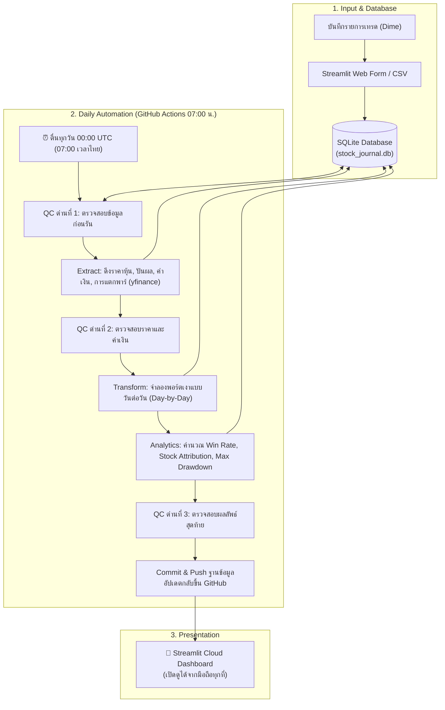

# 📈 Stock Journal & Shadow Benchmark System
> **บันทึกและระบบวิเคราะห์พอร์ตหุ้นสหรัฐฯ เปรียบเทียบผลตอบแทนกับ SPY/QQQ แบบพอร์ตเงารายวัน**  
> *โปรเจกต์ Data Engineering & Automation โดยนักเรียนมัธยมปลายผู้ลงทุนจริงผ่านแอป Dime!*

> 🛡️ **หมายเหตุเรื่องความเป็นส่วนตัวของข้อมูล (Data Privacy & Synthetic Dataset Notice):**  
> เพื่อปฏิบัติตามหลักความปลอดภัยของข้อมูลทางการเงินส่วนบุคคล ข้อมูลรายการซื้อขายในคลังโค้ดสาธารณะนี้เป็น **"ข้อมูลจำลองเชิงสถิติ (Realistic Synthetic / Mock Dataset)"** ที่จำลองพฤติกรรมการทยอยซื้อแบบ DCA, การซื้อเศษหุ้น (Fractional Shares), การจัดการกรณีพิเศษเรื่องวันหยุดตลาด และการแตกพาร์ 10:1 ของหุ้น NVDA โดยสถาปัตยกรรมข้อมูล ตรรกะเชิงวิศวกรรมข้อมูล (ETL Data Pipeline), การคำนวณคณิตศาสตร์ และระบบอัตโนมัติบน GitHub Actions ทั้งหมดยังคงเป็นระบบจริง 100% ครับ

---

## 💡 1. จุดเริ่มต้นของโปรเจกต์ (Why I Built This?)

ผมเป็นนักเรียนมัธยมคนหนึ่งที่เริ่มลงทุนในตลาดหุ้นสหรัฐฯ ผ่านแอป **Dime!** โดยใช้เงินเก็บทยอยซื้อเศษหุ้น (Fractional Shares) ทุกเดือน 

หลังจากลงทุนไปได้สักพัก ผมเริ่มตั้งคำถามกับตัวเอง 2 ข้อที่แอปไม่ได้บอก:
1. **"หุ้นที่เราเลือกเอง เหนื่อยอ่านงบแทบตาย สรุปแล้วเราชนะตลาดจริงไหม?"**  
   ในแอปบอกแค่ว่าพอร์ตเราบวกกี่บาท แต่ไม่เคยบอกเลยว่าถ้าเอาเงินจำนวนเดียวกัน วันเดียวกัน ไปซื้อกองทุนดัชนีเฉย ๆ อย่าง **SPY (S&P 500)** หรือ **QQQ (Nasdaq 100)** เราจะได้ผลตอบแทนดีกว่าหรือแย่กว่ากัน
2. **"เราซื้อหุ้นด้วยเหตุผลอะไร แล้วเหตุผลแบบไหนที่ทำเงิน?"**  
   เวลาซื้อหุ้น บางไม้ผมซื้อเพราะวิเคราะห์พื้นฐาน (Growth/Valuation) แต่บางไม้ผมก็ซื้อเพราะกลัวตกรถ (FOMO) ตามข่าวโซเชียล ผมอยากรู้ตัวเลขจริงว่าอารมณ์ไหนสร้างกำไร และอารมณ์ไหนพาพอร์ตพัง

ผมจึงตัดสินใจออกแบบสถาปัตยกรรมและพัฒนา **Data Pipeline อัตโนมัติขึ้นมา** เพื่อสร้างระบบ **"พอร์ตเงา (Shadow Portfolio)"** จำลองการลงทุนคู่ขนาน และเป็นกระจกสะท้อนการตัดสินใจลงทุนของผมครับ

---

## 🏗️ 2. ภาพรวมสถาปัตยกรรมระบบ (System Architecture)

ระบบนี้ถูกออกแบบให้ทำงานแบบอัตโนมัติ 100% บนคลาวด์ ไม่ต้องเปิดคอมพิวเตอร์ทิ้งไว้ที่บ้าน:



---

## 🛠️ 3. ปัญหาจริงที่เจอระหว่างพัฒนา และวิธีแก้เชิงวิศวกรรม (Engineering Challenges)

โปรเจกต์นี้ไม่ได้เขียนโค้ดตามตำราทั่วไป แต่ผมเจอปัญหาจริงของโลกข้อมูลการเงิน และได้ออกแบบตรรกะเชิงวิศวกรรมเพื่อแก้ปัญหา 3 เรื่องหลัก:

### 🥊 เรื่องที่ 1: ตลาดหุ้นมีวันหยุด (Market Holidays & Edge Cases)
* **ปัญหา:** ตลาดหุ้นสหรัฐฯ ปิดทำการในวันเสาร์-อาทิตย์ และวันหยุดนักขัตฤกษ์ (Market Holidays) หากมีรายการซื้อหุ้นที่เกิดขึ้นหรือถูกบันทึกในวันหยุดตลาด เช่น วันหยุดราชการสหรัฐฯ หรือคำสั่งซื้อล่วงหน้า จะทำให้ Yahoo Finance ไม่มีราคาหุ้นของวันนั้น ส่งผลให้ระบบเสี่ยงต่อการเกิดค่าว่าง (`NULL`) ในการคำนวณพอร์ตเงา
* **วิธีแก้:** 
  1. ในขั้นตอน Extract ออกแบบให้ระบบเผื่อเวลาถอยหลัง **7 วัน (Buffer)** ล่วงหน้า เพื่อให้มีราคาของวันทำการก่อนหน้ามารองรับเสมอ
  2. ใช้เทคนิค **`pivot`** แปลงตารางราคาให้เป็นทรงกว้าง แล้วใช้ **`.ffill() (Forward Fill)`** ดึงราคาปิดของวันทำการก่อนหน้า (วันศุกร์) มาเติมในวันหยุดเสาร์-อาทิตย์และวันหยุดนักขัตฤกษ์ ทำให้เส้นเวลามูลค่าพอร์ตมีความต่อเนื่อง 100% ไม่มีวันไหนแหว่ง

### 🥊 เรื่องที่ 2: ดักจับข้อมูลขยะก่อนระบบพัง (Garbage In, Garbage Out)
* **ปัญหา:** หากปล่อยให้ราคาหุ้นเป็นค่าว่าง (`NaN`), ค่าเงินบาทเป็น `0`, หรือจำนวนหุ้นติดลบหลุดเข้าไปในระบบ การคำนวณผลตอบแทนและกราฟทั้งหมดจะเพี้ยนทันที
* **วิธีแก้:** ผมออกแบบโมดูลควบคุมคุณภาพ **`data_quality.py`** ทำหน้าที่เป็น **Data Quality Gates** แบบ Fail-Fast ตรวจสอบความถูกต้องถึง 3 จุด (ก่อนดึงข้อมูล, หลังดึงข้อมูล, และหลังคำนวณ) หากพบความผิดปกติ โปรแกรมจะสั่งหยุดทำงานทันทีพร้อมบันทึกลงไฟล์ `stock_journal.log` เพื่อป้องกันข้อมูลผิดพลาดไม่ให้ไหลเข้าสู่ระบบ

### 🥊 เรื่องที่ 3: ปริศนาหุ้น NVDA ขาดทุน -70% (การแตกหุ้น / Stock Split)
* **ปัญหา:** ตอนซื้อหุ้น NVDA ในเดือนกุมภาพันธ์ 2024 ราคาหุ้นอยู่ที่ $630 พอเดือนมิถุนายน 2024 หุ้น NVDA ทำการแตกพาร์ 10 ต่อ 1 ทำให้ราคาตลาดลดลงเหลือ ~$180 ข้อมูลดิบที่บันทึกไว้เดิมยังเป็นจำนวนหุ้นก่อนแตกพาร์ ทำให้พอร์ตแสดงว่าขาดทุนยับ -70.38% ทั้งที่ความจริงกำไรเกือบ 200%!
* **วิธีแก้:** ผมออกแบบตรรกะการแก้ปัญหาโดยสร้างฟังก์ชัน `fetch_and_save_splits` และ `get_split_adjusted_trades` ดึงประวัติการแตกหุ้น (Corporate Actions) จาก Yahoo Finance มาเก็บไว้ในตาราง `stock_splits` และคำนวณปรับจำนวนหุ้นและต้นทุนย้อนหลังโดยอัตโนมัติ ส่งผลให้ข้อมูลหุ้น NVDA ถูกปรับจาก 0.125 เป็น 1.25 หุ้น และผลตอบแทนสะท้อนกำไรที่แท้จริงคือ **+196.16%** ถูกต้องตรงกับในพอร์ตจริง

---

## 📐 4. ตรรกะคณิตศาสตร์ของ "พอร์ตเงา" (Shadow Portfolio Math)

เพื่อให้การเปรียบเทียบเป็นธรรมที่สุด ระบบใช้หลักการจำลองเงินดอลลาร์เท่ากันเป๊ะในวันเดียวกัน:

1. **ทุกครั้งที่มีรายการซื้อหุ้นจริง:**  
   $$\text{เงินสดที่จ่ายไป} = (\text{จำนวนหุ้น} \times \text{ราคาหุ้น}) + \text{ค่าธรรมเนียม}$$
   พอร์ตเงาจะนำเงินก้อนนี้ ไปหาราคา **Adjusted Close ของ SPY และ QQQ** ณ วันเดียวกัน เพื่อซื้อหุ้นดัชนีเก็บไว้
2. **ทำไมต้องใช้ราคา Adjusted Close?**  
   เพราะกองทุน SPY และ QQQ มีการจ่ายเงินปันผลทุกไตรมาส การใช้ราคาปิดปกติ (`Close`) จะถือว่าเราตัดเงินปันผลที่ควรจะได้ออกไป การใช้ **`Adj Close`** จึงเป็นการคิดผลตอบแทนรวม (Total Return) ที่เป็นธรรมกับดัชนีที่สุด
3. **การวัดความเสี่ยงด้วย Max Drawdown (MDD):**  
   วัดว่าจากจุดสูงสุดที่พอร์ตเคยทำได้ เคยร่วงลงมาลึกที่สุดกี่เปอร์เซ็นต์ เพื่อสะท้อนความผันผวนและจิตวิทยาในการถือครอง:
   $$\text{Max Drawdown} = \min\left(\frac{\text{Value}_t - \text{Peak}_t}{\text{Peak}_t}\right) \times 100\%$$

---

## 🧰 5. เครื่องมือและเหตุผลที่เลือกใช้ (Tech Stack & Rationales)

| เครื่องมือ | หน้าที่ในโปรเจกต์ | เหตุผลที่เลือกใช้ |
| :--- | :--- | :--- |
| **Python** | ภาษาหลักในการพัฒนา | มีไลบรารีจัดการข้อมูลที่แข็งแกร่ง เหมาะสำหรับงาน Data Engineering |
| **SQLite** | ฐานข้อมูลหลัก (`stock_journal.db`) | ใช้งานง่าย เป็นไฟล์เดี่ยวแบบ Serverless รองรับ Composite Primary Key ป้องกันข้อมูลซ้ำ และปลอดภัยจาก SQL Injection |
| **pandas** | ประมวลผลและแปลงข้อมูล | จัดการข้อมูลแบบ Vectorized ได้รวดเร็ว เหมาะกับการทำ Pivot และ Forward Fill |
| **yfinance** | ดึงข้อมูลราคาหุ้นและค่าเงิน | ดึงราคาปิด, ปันผล, ค่าเงิน USD/THB และประวัติการแตกพาร์ย้อนหลังได้ครบถ้วน |
| **GitHub Actions** | รันระบบอัตโนมัติบนคลาวด์ | ตั้งเวลาผ่าน Cron `0 0 * * *` (00:00 UTC = 07:00 น. เวลาไทย หลังตลาดสหรัฐฯ ปิด) ให้ตื่นมารันเองทุกวันฟรี |
| **Streamlit** | เว็บ Dashboard บนมือถือ | สร้างเว็บแอปด้วย Python ล้วน ทำให้เข้าใจการทำงานของทุกส่วนได้ชัดเจน และต่อกับระบบหลังบ้านได้ทันที |

---

## 💻 6. วิธีการติดตั้งและรันใช้งาน (Local Setup)

```bash
# 1. โคลนคลังโค้ด
git clone https://github.com/lufus4826-eng/stock-journal.git
cd stock-journal

# 2. ติดตั้งแพ็กเกจที่จำเป็น
pip install -r requirements.txt

# 3. สั่งรัน Pipeline หลังบ้าน (ดึงข้อมูล + คำนวณ + ตรวจสอบ QC)
python pipeline.py

# 4. เปิดหน้าเว็บ Dashboard
streamlit run app.py
```

---

## 🎯 7. สิ่งที่ผมได้เรียนรู้และการพัฒนา (Key Takeaways & Methodology)
* **Data Integrity มาก่อนเสมอ:** การออกแบบฐานข้อมูลไม่ใช่แค่สร้างตาราง แต่ต้องคิดถึงความถูกต้อง เช่น การใช้ Composite Primary Key ในตารางราคา เพื่อป้องกันการบันทึกข้อมูลซ้ำซ้อน
* **Production vs Script:** ความแตกต่างระหว่างการเขียนสคริปต์ทั่วไปกับการทำ Production Data Pipeline คือการมี **Data Quality Gates, Exception Handling, และ Structured Logging**
* **Development Methodology (AI-Assisted Pair Programming):** ในโปรเจกต์นี้ ผมทำหน้าที่เป็น **System Architect & Logic Designer** โดยเป็นผู้กำหนดโจทย์ปัญหา ออกแบบสถาปัตยกรรมข้อมูล และตรวจสอบความถูกต้องของตรรกะทุกขั้นตอน โดยใช้ AI เสมือนเป็น Junior Developer / Pair Programmer ช่วยพิมพ์ Boilerplate Code และช่วยสืบค้นข้อผิดพลาด ซึ่งทำให้ผมเข้าใจการทำงานของระบบลึกซึ้งในทุกบรรทัดครับ
